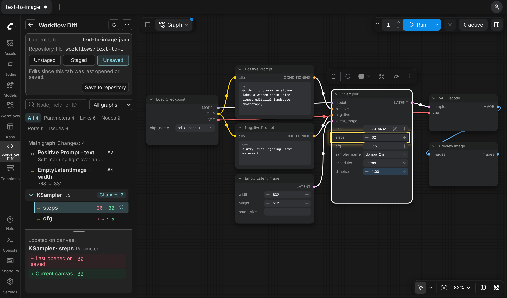
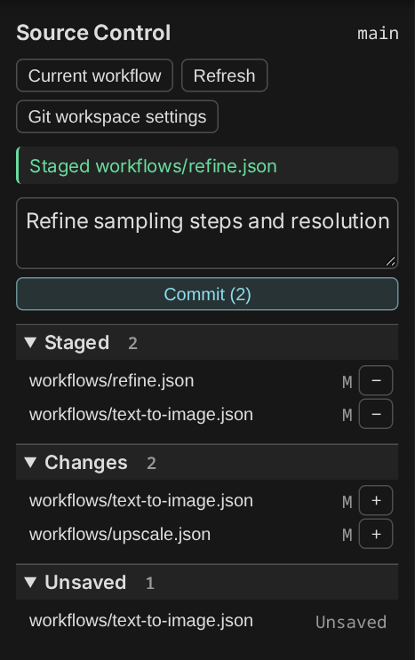

# ComfyDiff

**Workflow diffs and Git source control for ComfyUI**

[简体中文](README.zh-CN.md) · English

ComfyDiff is a Git sidebar for ComfyUI workflows. Review changes to nodes, parameters, links, and subgraphs next to the canvas. Jump from a change to its location, then stage and commit the files you've reviewed.

The interface supports English and Simplified Chinese. Select your language under **Comfy → Language** in ComfyUI settings and refresh the page. ComfyDiff uses English for other languages.



## Installation

Enable **Nodes 2.0** in ComfyUI. Git features require `git` on the machine running ComfyUI. ComfyDiff was tested with ComfyUI frontend `1.57.6`. [Nodes 2.0 guide](https://docs.comfy.org/interface/nodes-2)

Place the project directory at `ComfyUI/custom_nodes/ComfyUI-ComfyDiff/` with `__init__.py` directly inside it. Restart ComfyUI and refresh the page. **Workflow Diff** will appear in the left sidebar. [ComfyUI custom node installation guide](https://docs.comfy.org/installation/install_custom_node)

## Quick start

1. Prepare a Git repository that contains your workflow JSON files. If your workflows are already in a regular folder, run `git init` there.
2. Open **Workflow Diff** in the left sidebar and choose **Git workspace settings** from the menu in the upper right. Browse to the **repository root on the ComfyUI server** and click **Select this folder**.
3. Choose **Open repository workflow** from the same menu. Try changing `steps` on a `KSampler` node from `20` to `28`, then review both values under **Unsaved**. Click the locate icon next to the change to jump to that parameter.
4. Save the workflow. Use ComfyUI's save button for files in its workflow directory. For files outside that directory opened through ComfyDiff, use **Save to repository**. Review the saved changes under **Unstaged**.
5. Click the back arrow in the upper left to open **Source Control**. Click `+` next to a file under **Changes** to stage it, or `−` next to a file under **Staged** to unstage it. Review the **Staged** list, enter a commit message, and click **Commit**.



## Comparison sources

The diff view follows the active workflow tab by default.

| Sidebar option | What it compares |
| --- | --- |
| Unstaged | The staged version and the saved file on disk |
| Staged | The checked-out commit and the staged version |
| Unsaved | The version from when the tab was last opened or saved and the current canvas |

Suppose `steps` was `20` in the last commit, staged at `28`, saved to disk at `30`, and then edited to `32` on the canvas. **Staged** shows `20 → 28`, **Unstaged** shows `28 → 30`, and **Unsaved** shows `30 → 32`.

## Everyday use

- **Review canvas changes.** Search by node name, parameter name, or `#ID`, and filter by change type or subgraph. Select a change to see its before and after values and highlights on the canvas. Click the node ID or locate icon to jump to it. You can inspect deleted nodes and links, or open the staged version in a read-only view. For changes to layout or JSON formatting alone, check the file status in **Source Control**.
- **Switch workflows.** Click a workflow under **Changes** to open an editable tab. If a tab is already open for the same repository path, ComfyDiff switches to it and keeps your canvas edits. Use **Associate repository file** to choose a file to compare with the current tab.
- **Find workflow issues.** The **Issues** tab lists missing models, nodes, and media, along with validation and execution errors. Expand an entry to see which nodes are affected. This tab is also available without a Git workspace.

Staging uses the file on disk. A commit includes everything in the staging area, including files staged from the terminal. Git runs under the system account that runs ComfyUI and uses the Git configuration for that account and repository.

**Save to repository** is available for tabs whose saved file version ComfyDiff has recorded. If another program changes the file after you open it, ComfyDiff reports a save conflict and preserves your canvas edits.

## Development

Run the tests from the ComfyDiff directory.

```sh
python -m unittest discover -s tests
node --test tests/*.test.mjs
```

See [requirements and acceptance scenarios (Chinese)](docs/requirements.md) for comparison rules, interaction details, and acceptance cases.

Interface text lives in the [English catalog](web/locales/en.js) and the [Simplified Chinese catalog](web/locales/zh.js). Use the same keys and placeholders in both files when adding text.
