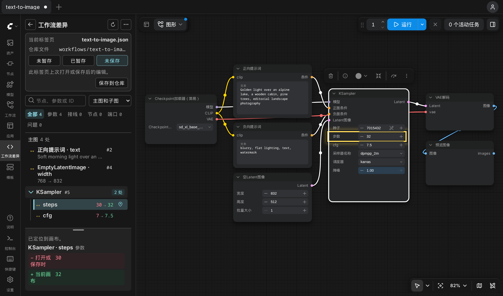
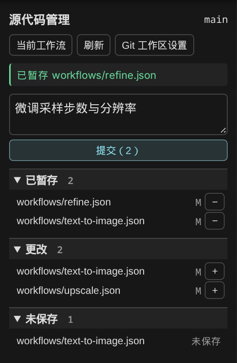

# ComfyDiff

**ComfyUI 工作流差异与 Git 源代码管理**

简体中文 · [English](README.md)

ComfyDiff 是 ComfyUI 的工作流 Git 侧栏。在画布旁查看节点、参数、接线和子图的改动，点击差异定位到对应位置，再把确认过的文件暂存并提交。

界面支持简体中文和英语，跟随 ComfyUI 的「语言」设置。更改语言后刷新页面即可生效；其他语言使用英语。



## 安装

在 ComfyUI 中启用 **Nodes 2.0**。Git 功能需要在运行 ComfyUI 的机器上可执行的 `git`。ComfyDiff 已在 ComfyUI 前端 `1.57.6` 上验证。[Nodes 2.0 启用指南](https://docs.comfy.org/zh-CN/interface/nodes-2)

将本项目的源码目录放到 `ComfyUI/custom_nodes/ComfyUI-ComfyDiff/`，确认 `__init__.py` 位于该目录的第一层。重启 ComfyUI 并刷新页面，左侧会出现「工作流差异」。[ComfyUI 自定义节点安装指南](https://docs.comfy.org/installation/install_custom_node)

## 快速开始

1. 准备一个包含工作流 JSON 的 Git 仓库。如果工作流已经放在一个普通目录里，可以在目录中运行 `git init`。
2. 打开左侧的「工作流差异」，从右上角菜单进入「Git 工作区设置」。在目录选择器中选中 **ComfyUI 服务器上的仓库根目录**，点击「选择此文件夹」。
3. 在同一个菜单里选择「打开仓库工作流」。例如，把 `KSampler` 的 `steps` 从 `20` 改到 `28`，再看「未保存」中的前后值。点差异行旁的定位图标，可跳到这个参数。
4. 保存工作流。原生工作流目录中的文件使用 ComfyUI 的保存按钮。通过插件新打开的目录外文件使用侧栏的「保存到仓库」。保存后可在「未暂存」中查看磁盘改动。
5. 点击左上角返回箭头进入「源代码管理」。点「更改」中文件旁的 `+` 暂存，点「已暂存」中文件旁的 `−` 取消暂存。确认「已暂存」列表后，填写提交说明并点击「提交」。



## 比较来源

差异页默认跟随当前工作流标签。

| 侧栏选项 | 比较内容 |
| --- | --- |
| 未暂存 | 暂存版本与磁盘上已保存的文件 |
| 已暂存 | 当前检出的提交与暂存版本 |
| 未保存 | 此标签页上次打开或保存时的内容与当前画布 |

例如，`steps` 上次提交是 `20`，暂存时是 `28`，后来保存为 `30`，画布上又编辑到 `32`。三个来源分别显示 `20 → 28`（已暂存）、`28 → 30`（未暂存）和 `30 → 32`（未保存）。

## 日常使用

- **审查画布改动。** 按节点名、参数名或 `#ID` 搜索，再按差异类别或子图范围筛选。点击差异行查看前后值和画布标记，点击节点 ID 或定位图标跳转。删除项可查看旧节点和旧接线，已暂存版本可按需在只读图中查看。只调整布局或 JSON 格式时，可以在「源代码管理」里查看文件状态。
- **切换工作流。** 从「更改」点击文件会直接打开可编辑标签。按仓库相对路径找到已有标签时，ComfyDiff 会切回原标签并保留画布编辑。手动指定比较对象时，使用「关联仓库文件」。
- **定位工作流问题。** 「问题」标签汇总缺失的模型、节点和素材，以及参数校验与运行错误。展开条目可查看受影响的节点。这个标签也可以独立于 Git 工作区使用。

暂存使用磁盘文件。提交包含整个暂存区，包括通过终端暂存的文件。Git 命令由运行 ComfyUI 的系统账号执行，提交使用该账号与仓库的 Git 配置。

「保存到仓库」适用于插件已记录磁盘版本的标签。文件打开后若被其他程序改写，保存会提示冲突并保留画布编辑。

## 开发

在插件目录运行测试。

```sh
python -m unittest discover -s tests
node --test tests/*.test.mjs
```

差异规则、交互细节和验收用例收录在 [需求与验收场景](docs/requirements.md)。

插件文案集中在 [英文语言文件](web/locales/en.js)和[简体中文语言文件](web/locales/zh.js)。添加文案时，两份文件使用相同的键和占位符。
